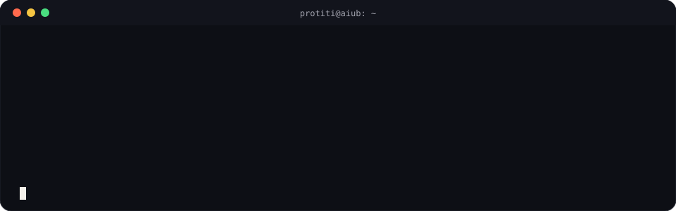

  

  
  
  

## 🧑‍💻 About me

I'm a Computer Science and Engineering student at **American International University-Bangladesh (AIUB)**, working toward a career in **quality assurance**. I've done hands-on Selenium testing, debugging and statistical analysis, and research taught me to question every result before I trust it. I use the same habit on software: find defects early, improve quality, and help ship products people can rely on.

## 🛠️ Toolbox

  
  
  
  
  
  
  
  
  

| | |
|---|---|
| 🧪 **Testing & QA** | Selenium · Debugging · Statistical analysis · Attention to detail |
| 💬 **Languages** | Java · C# · C++ · HTML · CSS · JavaScript |
| 🗄️ **Databases** | MySQL · SQL Server |
| 🧠 **Core** | OOP · Database design · Query optimization · Problem-solving |
| 🤝 **Soft skills** | Team collaboration · Communication |

## 🚀 Projects

| Project | What it is | Built with |
|---|---|---|
| 🎨 **[Art Gallery Management System](https://github.com/ProtitiPrachi/ArtGalleryManagement)** [▶ live demo](https://protitiprachi.github.io/ArtGalleryManagement/) | Desktop app for a Van Gogh gallery: artworks, a shop with cart and checkout, and an admin who manages the catalog. Runs in the browser through CheerpJ. | Java, Swing |
| 🌐 **[Portfolio](https://github.com/ProtitiPrachi/ProtitiPrachi.github.io)** [▶ live](https://protitiprachi.github.io/) | My personal site, with an admin dashboard that edits every section and redeploys on publish. | Next.js, React, GitHub Actions |
| 📚 **SkillHub** | Full-stack learning platform where courses, lessons and progress live in one place. | React, Next.js, FastAPI, PostgreSQL |
| 💼 **Job Portal** | Job board where people search openings, keep accounts and apply. | HTML, CSS, JavaScript, PHP, MySQL |
| 🦁 **Zoo Management System** | Desktop app for day-to-day zoo work: visitor tickets, memberships and transactions. | C#, WinForms, SQL Server |
| 🧪 **Selenium test suite for Job Portal** *(planned)* | Automated end-to-end tests for sign-up, job search and applying, with a written test plan and bug reports. | Selenium |

## 🔍 My year, under test

  

## 📄 Research

- **Explainable and Generalizable Deepfake Detection for Vishing Attack Recognition** 
  *Paper accepted, to be published in the IEEE conference proceedings* · I-COSTE 2026: Sustainable Technology for Humanity and Global Impact
- **Quantifying the Risks of Self-Medication: A Statistical Analysis of Commonly Misused Drugs in Bangladesh** 
  *Abstract published, presented as a poster* · National Biomedical & Health Research Conference (NBHRC) 2025
- **Transformational Leadership and Organizational Change in Bangladeshi Higher Education Institutions** 
  *Abstract published* · 7th International Conference on Integrated Sciences (ICIS) 2025

## 🏆 Honors

| | |
|---|---|
| 🏅 **Dean's Award** | AIUB |
| 📜 **I-COSTE 2026** | Paper acceptance certificate; to be published in the IEEE conference proceedings |
| 🎤 **NBHRC 2025** | Presenting author, abstract and poster |
| 🎓 **IT Essentials** | Cisco Networking Academy |
| 💻 **AIUB Programming Contest** | C++, 2024 |

## 🌱 Beyond code

- 📸 General Member, Media & Publication, **AIUB Computer Club**
- 🙋 Volunteer at the **AIUB Cyber Gaming Fest and CS Fest**
- 🎶 Singer, trained at **Bangladesh Shilpakala Academy**

 

  

